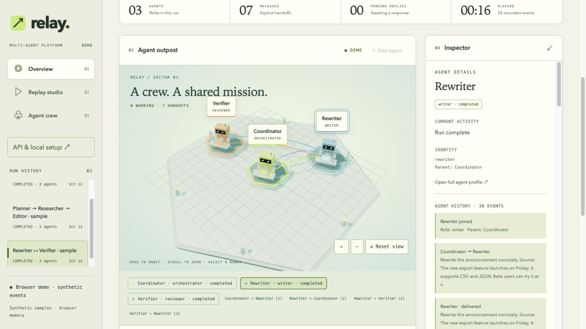

# Relay · 多智能体平台

[English](README.md) · [在线演示](https://jiayi-liao.github.io/multi-agent-platform/) · [API 与接入指南](https://jiayi-liao.github.io/multi-agent-platform/api.html)

用 Three.js 工作站观察任意角色的 Agent，记录任务交接、确认收件、工具执行和版本化产物，并回放整个过程。改写 / 验证只是内置示例，未来角色无需改动界面即可接入。

默认英文。点击右上角 **中文 / EN** 切换语言，设置会跨页面、刷新保留。总览、回放、智能体档案、看板规划说明和 API 指南均支持中文；Agent 名称、角色、消息、代码和产物保持原文。深浅主题独立保存。



## 本地启动

需要 Node.js 22.13 或更高版本。

```sh
git clone https://github.com/Jiayi-Liao/multi-agent-platform.git
cd multi-agent-platform
npm ci --ignore-scripts
npm start
```

打开 http://localhost:4310，点击“启动演示”。确定性演示无需 API Key，包含拒绝 → 修订 → 接受的完整过程。也可运行 `npm run demo`。

如需真实模型演示，安装并登录官方 Codex CLI，以 `ENABLE_CODEX=1 npm start` 启动，然后选择 Codex CLI 模式或运行 `npm run demo:codex`。模型调用会使用你的 CLI 账号及额度，默认沿用现有配置。可使用 `CODEX_MODEL`、`CODEX_BIN` 和 `CODEX_IGNORE_USER_CONFIG=1` 指定进程级配置。

## 界面

- **总览**：3D 工作站、运行指标、最新产物与成员入口。拖动旋转、滚动缩放，选择机器人或通信路径。
- **回放工作室**：当前事件、播放 / 暂停、逐步跳转、倍速、章节和完整事件日志。历史列表最新在前；时间轴正向推进。未来事件在日志中变暗，点击后还原对应时刻，不重新执行模型或工具。
- **智能体团队**：按名称 / 角色搜索，查看父子关系、活动、历史、消息、产物和工具。所有列表按事件倒序；档案仅包含回放位置已发生的内容。
- **产物时间**：总览、详情和 Agent 产物列表显示日期、时分秒、毫秒、时区、运行内相对时间与源事件序号。ISO 时间可通过悬停查看。
- **Dashboard / 看板**：目前为规划入口，完整功能尚未实现。参见[独立实施计划](artifacts/dashboard-plan.zh-CN.md)。

空状态可新建运行、添加任意角色，在详情中发消息，或通过 HTTP / JavaScript 客户端接入外部运行时。导出为 JSON，本地历史在重启后保留。

## 接入与 API

API 仅监听本机 `127.0.0.1:4310`。POST 要求 JSON，同源浏览器写入，请求体最多 128,000 字节。详见支持语言切换的 [API 指南](public/api.html)；完整接口表也在 [English README](README.md#api)。

```js
import { PlatformClient } from './src/client.js';
const planner = new PlatformClient({ agentId: 'planner' });
const run = await planner.createRun('研究审核');
await planner.register({ name: '规划员', role: 'planning' });
const reviewer = new PlatformClient({ runId: run.id, agentId: 'reviewer' });
await reviewer.register({ name: '审核员', role: 'review' });
const task = await planner.send('reviewer', '请审核这份方案。');
await reviewer.ack(task.id, 'delivered');
await reviewer.ack(task.id, 'processing');
const reply = await reviewer.reply(task, '审核完成，方案可行。');
await planner.ack(reply.id, 'delivered');
await planner.ack(reply.id, 'answered');
await reviewer.record('artifact.created', {
  name: '审核结果', content: '方案可行。', version: 1
});
await planner.finish();
```

支持 run 创建 / 查询 / 完成 / 取消 / 导出、Agent 注册、消息发送 / 回复 / 收件箱 / ACK、状态 / 工具 / 产物事件和 SSE。收件箱保留“最早优先”的处理语义，API / SSE / 导出按提交顺序返回，UI 历史倒序展示。

消息遵循 queued → delivered → processing → answered，可进入 failed 终态。需要回复的请求必须收到相关回复，不能仅靠 ACK 声称完成。相同显式 ID 和 conversationId 可幂等重试，冲突返回 409。完成后的 run 只读。中断的 run 重启后标记失败并保留历史，不自动恢复 worker。

当前没有 MCP 服务、线上 API、账号系统，也不自动捕获任意 Codex Desktop 对话或原生子 Agent 消息。Agent ID 是路由标识，不是认证身份；远程部署前需补充认证与授权。

## Pages 与数据

```sh
npm run build:pages
npm run preview:pages
# http://localhost:4311/multi-agent-platform/
```

GitHub Pages 仅发布允许清单内的静态资源和新生成的模拟数据，不加载本地 `.runtime/events.sqlite`、真实 CLI 历史或凭证。浏览器演示数据只存在内存中。推送 main 后 GitHub Actions 自动检查、构建并部署。

存储：SQLite WAL 追加事件日志 → SSE → 共享纯状态投影 → 3D / 列表 / 详情 / 回放。按提交序号决定显示顺序，时间戳相同或时钟偏移不会颠倒事件。Three.js 离屏暂停、限制像素密度、释放资源并尊重减少动态效果设置。

## 验证与后续

```sh
npm run check
npm test
npm run build:pages
```

当前范围包括记录、通信、回放和 Codex 演示适配器。大历史仍一次载入内存；分页、状态快照和列表虚拟化属于后续工作。Dashboard 计划单独定义有界指标查询、看板版本、幂等、曲线回放与实施阶段。

通信设计参考 [Open Agent Bridge](https://github.com/kevinArgueta96/open-agent-bridge)，为独立实现，不是 fork 或协议兼容客户端。MIT 许可。
